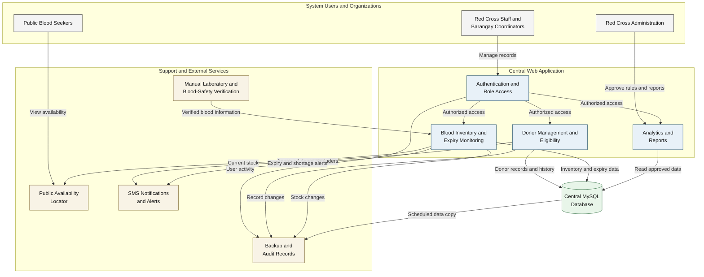

# Subsystem Integration Activity

## Davao del Sur Blood Repository and Donor Monitoring System

## 1. Chosen Application

The chosen application is the proposed **Davao del Sur Blood Repository and Donor Monitoring System**.

It is a responsive Laravel and MySQL web application for the Philippine Red Cross Davao del Sur Chapter and designated Barangay Health Coordinators.

The system will help authorized users manage donor records, eligibility, blood inventory, expiry information, reports, alerts, backups, and audit records. Public users will only view approved blood availability information.

## 2. Activity Objectives

This activity applies subsystem integration concepts to the proposed blood repository system. It aims to:

- Break the project into connected subsystems.
- Identify technical and organizational responsibilities.
- Map data flows and dependencies.
- Find critical paths and possible failure points.
- Suggest practical ways to improve reliability, security, and user experience.

## 3. Subsystem Identification

The project has more than six subsystems. They are grouped into core, supporting, external, and organizational subsystems.

### 3.1 Technical Subsystems

| Subsystem | Type | Main responsibility | Main data handled |
| --- | --- | --- | --- |
| Authentication and Role Access | Core technical | Login, user roles, and permissions | User accounts, roles, access records |
| Web Application Interface | Core technical | Main pages and forms used by staff | Requests, forms, results, messages |
| Donor Management and Eligibility | Core technical | Donor profiles, history, eligibility, and deferrals | Donor details, donation history, status dates |
| Blood Inventory and Expiry Monitoring | Core technical | Blood stock, verification, expiry, and adjustments | Blood type, bags, quantity, dates, status |
| Central MySQL Database | Core technical | Shared storage for approved system records | Donor, inventory, user, report, and audit data |
| Analytics and Reports | Supporting technical | Stock, donor, shortage, and expiry reports | Summaries and calculated results |
| Public Availability Locator | Supporting technical | View-only blood availability for the public | Approved blood availability and refresh time |
| SMS Notifications and Alerts | External service integration | Donor reminders, shortage notices, and expiry alerts | Approved message, recipient, delivery status |
| Backup and Audit Records | Supporting technical | Data copies, restoration, and activity history | Backups, operator, action, reason, timestamp |

### 3.2 Organizational Subsystems

| Subsystem | Type | Main responsibility |
| --- | --- | --- |
| Red Cross Administration | Organizational | Approves policies, scope, budget, and ownership |
| Red Cross Personnel | Human workflow | Enters donor and inventory data and checks records |
| Barangay Health Coordinators | Human workflow | Registers donors, supports field work, and helps adoption |
| IT and Development Team | Organizational and technical | Builds, secures, deploys, maintains, and supports the system |
| Laboratory and Blood-Safety Verification Process | Organizational workflow | Manually confirms approved blood and safety information |
| Public Blood Seekers | External user group | Views approved blood availability information |

## 4. Core and Supporting Subsystems

### Core subsystems

These are required for the main system to operate:

1. Web Application Interface.
2. Authentication and Role Access.
3. Central MySQL Database.
4. Donor Management and Eligibility.
5. Blood Inventory and Expiry Monitoring.

### Supporting subsystems

These improve continuity, decision-making, and public access:

1. Analytics and Reports.
2. Public Availability Locator.
3. SMS Notifications and Alerts.
4. Backup and Audit Records.
5. Training, support, and change-management workflow.

## 5. Subsystem Interaction Diagram

## 6. Main Data Flows and Integration Points

| Data flow | From | To | Integration point | Why it matters |
| --- | --- | --- | --- | --- |
| Staff login and permissions | Staff or coordinator | Authentication | Login and role check | Prevents unauthorized access |
| Donor information | Authorized staff | Donor Management | Web form to application and database | Keeps donor records organized |
| Inventory information | Authorized staff and verification process | Blood Inventory | Approved form and validation rules | Keeps stock information accurate |
| Shared records | Donor and Inventory modules | MySQL Database | Database tables and relationships | Creates one shared source of truth |
| Current blood stock | Inventory module | Public Locator | Approved view-only data | Gives the public current information without private data |
| Donor reminder | Donor Management | SMS service | Approved message request | Helps notify eligible or future donors |
| Expiry or shortage alert | Inventory module | SMS service | Alert event and delivery status | Supports faster action on stock risks |
| Report data | Database | Analytics and Reports | Queries and calculations | Supports planning and decisions |
| User activity | Application modules | Audit Records | Operator, reason, quantity, and timestamp | Makes changes traceable |
| Database copy | MySQL Database | Backup service | Scheduled backup process | Supports recovery after data loss |
| Blood verification | Laboratory and safety process | Inventory module | Manual approval before stock use | Prevents unverified information from being treated as final |

## 7. Critical Paths

### Critical Path 1: Staff access to records

**Flow:** Staff login -> Authentication and Role Access -> Web Application -> MySQL Database.

If authentication fails, staff cannot safely use the system. If the database is unavailable, the main donor and inventory functions also become unavailable.

**Impact:** High.

**Suggested protection:** Role-based permissions, secure password storage, session protection, database monitoring, and a clear safe-error message.

### Critical Path 2: Blood inventory to public availability

**Flow:** Verified inventory data -> Blood Inventory -> MySQL Database -> Public Availability Locator.

If inventory data is wrong or outdated, the public may see incorrect availability information.

**Impact:** High because it can affect public decisions and trust.

**Suggested protection:** Verification status, approved publishing rules, refresh timestamp, no-reservation notice, and regular reconciliation with physical records.

### Critical Path 3: Inventory to expiry and shortage alerts

**Flow:** Inventory record -> Expiry or shortage rule -> SMS Notifications and Alerts.

If the alert process fails, staff may not receive important reminders about stock that needs attention.

**Impact:** High.

**Suggested protection:** Store alert events, record delivery status, retry temporary failures, display failed notifications to the technical owner, and keep staff checks as a backup.

### Critical Path 4: Database to backup and recovery

**Flow:** MySQL Database -> Scheduled Backup -> Restore Procedure.

If backups are incomplete or never tested, the project may lose important records during a failure.

**Impact:** High.

**Suggested protection:** Scheduled backups, protected backup storage, backup-success logs, regular restoration tests, and a written recovery procedure.

## 8. Major Integration Challenges and Solutions

### Challenge 1: Data consistency

Donor, inventory, public locator, reports, and alerts may use the same information. If one module is updated while another still uses old information, users may see different results.

**Possible solutions:**

- Use the central MySQL database as the approved source of records.
- Define one owner for important data.
- Use validation rules and database constraints.
- Add timestamps to public availability and reports.
- Reconcile digital stock with physical stock regularly.
- Keep an audit record for corrections.

### Challenge 2: Security and privacy

The system contains donor information and operational blood records. A public page must not expose private data or allow public changes.

**Possible solutions:**

- Use role-based access control.
- Separate public routes from staff routes.
- Show only approved availability fields publicly.
- Protect passwords and sessions.
- Use HTTPS in deployment.
- Log important actions.
- Restrict backup access.
- Review inactive accounts regularly.

### Challenge 3: Interoperability with SMS and hosting services

The SMS service and hosting environment are outside the core application. Their formats, availability, limits, and costs may differ from the project’s needs.

**Possible solutions:**

- Use documented service interfaces.
- Keep the SMS integration behind one application service.
- Store message and delivery status.
- Define timeout and retry behavior.
- Use a test environment before production.
- Keep the notification feature from blocking ordinary record updates.
- Record vendor ownership and support contacts.

### Challenge 4: Latency and slow connections

Field coordinators may use mobile browsers and 3G/4G connections. Slow pages can cause repeated submissions or incomplete work.

**Possible solutions:**

- Keep forms short and organized.
- Add indexes for donor and inventory searches.
- Return only the data needed for each page.
- Paginate long lists.
- Avoid loading reports on every page.
- Show clear loading and success states.
- Test using the target mobile conditions.

### Challenge 5: Connectivity, power, and service failure

Internet, hosting, SMS, or electricity problems may interrupt the work.

**Possible solutions:**

- Provide UPS support where planned.
- Show a clear service-unavailable message.
- Define whether the system is online-only or supports approved offline work.
- Do not claim that an update succeeded until the server confirms it.
- Keep a temporary approved manual procedure for outages.
- Reconcile any manual records after service recovery.

### Challenge 6: Human workflow and adoption

Staff may continue using paper records or enter incomplete information if the new process is difficult.

**Possible solutions:**

- Involve staff and coordinators during design.
- Use role-specific training.
- Provide simple Bisaya or Tagalog guides where useful.
- Use a two-week approved dual-processing period.
- Assign peer support or Digital Buddies.
- Collect weekly feedback during the pilot.
- Set a clear approved date for paper-record retirement.

### Challenge 7: Vendor lock-in

Depending too heavily on one SMS provider, hosting provider, or proprietary service may make future changes costly.

**Possible solutions:**

- Keep the core donor and inventory data in the project-owned database.
- Use standard database exports and documented data formats.
- Keep the SMS integration replaceable behind one service boundary.
- Document hosting, deployment, and backup steps.
- Confirm data ownership and export rights in writing.
- Review recurring vendor costs every year.

## 9. Answers to the Guide Questions

### Which subsystems are core?

The core subsystems are the web application, authentication and role access, the central database, donor management, and blood inventory. Without these, the main staff functions cannot operate.

### Which subsystems are supporting?

Analytics and reports, public availability, SMS alerts, backup and audit records, training, and change-management activities are supporting subsystems. They are important, but they depend on the core records and access controls.

### Are any subsystems overlapping?

Donor Management and Eligibility may overlap with Analytics when donor trends are calculated. Blood Inventory may overlap with Reports when stock summaries are displayed. These should not create separate copies of the same official data. Reports should read approved records from the central database.

### What are the main data flows?

The main flows are staff access to the web application, donor and inventory data to the central database, current stock to the public locator, donor and inventory events to SMS alerts, and application activity to audit records and backups.

### Which subsystems would cause the greatest disruption if they failed?

Authentication, the central database, and blood inventory would cause the greatest disruption. Authentication failure blocks authorized work. Database failure affects most modules. Inventory failure affects staff decisions, public availability, and expiry or shortage monitoring.

### What risks arise when integrating third-party systems?

The project may face service downtime, slow responses, changed APIs, message delivery failure, data exposure, usage limits, and increased recurring costs. The team must also know who owns the vendor account and the data.

### How can redundancy or backups strengthen reliability?

The team can use scheduled database backups, protected backup storage, tested restoration, audit logs, UPS support, monitoring, and approved manual procedures during outages. A backup is only useful if the team can restore it and verify the restored information.

## 10. Reflection

### If we were the system architects, what would we improve?

We would improve the integration design in five ways:

1. Finalize the permission matrix before development.
2. Keep one central source of truth for donor and inventory data.
3. Separate the public locator from protected staff operations.
4. Design failure handling for SMS, backup, internet, and power problems.
5. Test complete workflows with realistic but approved test data before launch.

We would also keep the first version focused. Online reservations, laboratory-device integration, native mobile applications, and national system integration should remain outside Phase 1 unless stakeholders approve them later.

### How do subsystem interactions affect the user experience?

Good integration lets staff enter information once and use it in the correct reports, alerts, and approved public views. It reduces repeated work and makes information easier to trust.

Poor integration can show old stock, send incorrect alerts, slow down searches, or expose private information. Therefore, the user experience depends not only on page design but also on reliable data flow, fast responses, clear errors, and safe access rules.

## 11. Recommended Improvements

Before development, the team should complete:

- A final functionality matrix.
- A data dictionary.
- A role and permission matrix.
- Detailed donor and inventory process maps.
- A database relationship diagram.
- Acceptance criteria for every core function.
- Backup and restoration tests.
- SMS failure and retry rules.
- Public locator approval rules.
- A traceability table connecting problems, objectives, functions, tests, and success measures.

## 12. Conclusion

The Blood Repository and Donor Monitoring System is a suitable example of subsystem integration because it combines human workflows, a web application, a shared database, access control, inventory records, public information, reports, SMS services, backups, and audit records.

The most important integration principle is to keep verified donor and inventory records controlled in one central system while giving each user only the access needed for their role.

The project should move from requirements validation to design only after the scope, data rules, permissions, failure handling, testing, and ownership have been approved.
