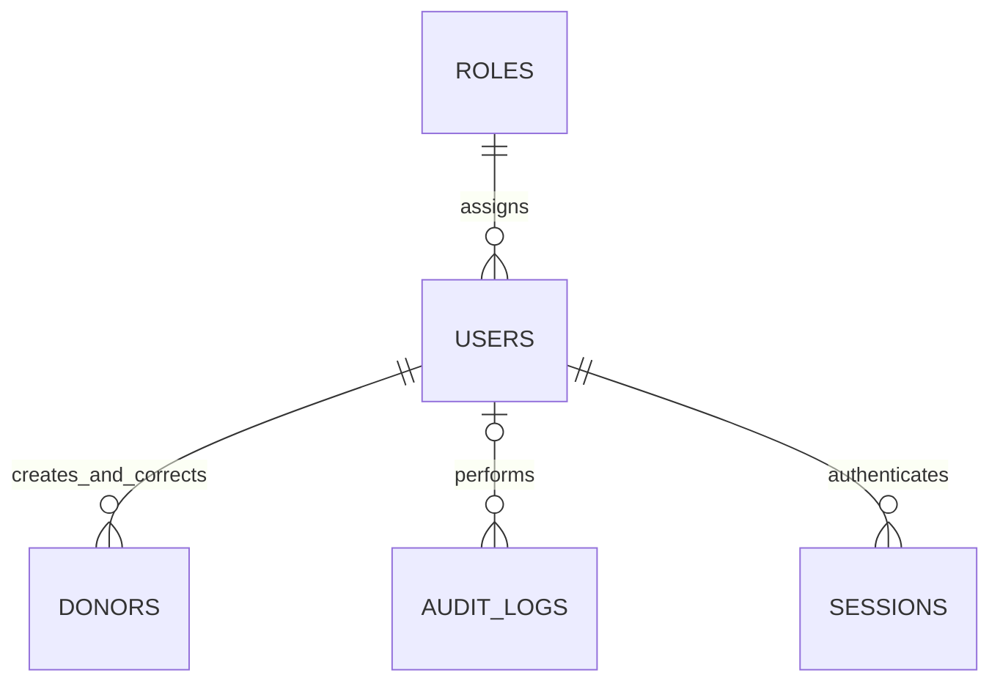

# Backend foundation decisions

Historical 6 November foundation baseline. The 9 November [connected implementation](OPERATIONS.md) supersedes the access matrix and deferred-feature status below; explicit assignments, donation history, inventory, alerts, clinical records and local SQLite recovery are now implemented.

Status: local development baseline for review, 6 November 2026. These decisions implement the first milestone and do not approve production data collection or medical workflows.

## Runtime and architecture

- Laravel 13, portable PHP 8.4 in the workspace, and Composer lockfile. The existing XAMPP PHP installation is preserved.
- One application, one deployment, versioned JSON API and a same-origin frontend. Session cookies and CSRF protect browser writes. Sanctum authenticates the first-party session; no bearer tokens are stored in localStorage.
- MySQL remains the target production engine. Local SQLite is explicitly used for a runnable development database and isolated automated tests while no approved MySQL service is configured. Do not report MySQL validation until migrations and feature tests run against a dedicated MySQL database.
- Controllers handle HTTP, form requests validate, policies enforce record-level access, API resources allowlist fields, and a small donor action service commits donor writes and audit events together. No generic repository layer is needed.

## Initial field dictionary

| Entity / field | Meaning / type | Required / validation | Privacy / owner | Retention |
| --- | --- | --- | --- | --- |
| User ID | Internal integer | Server generated | Restricted / technical owner | Pending approval |
| User name, email | Account identity / strings | Required, unique email | Restricted / technical owner | Pending approval |
| User password | Framework password hash | Never returned | Secret / technical owner | Credential lifecycle |
| User role | Foreign key to role | Approved seeded role | Restricted / technical owner | Pending approval |
| User active | Account access state / boolean | Defaults active for provisioned accounts | Restricted / technical owner | Pending approval |
| Donor ID | UUID reference | Server generated, unique | Restricted / operational owner | Pending approval |
| Donor name | Full display name / string | Required, 2–120 characters, nonblank | Personal / operational owner | Pending approval |
| Donor blood_type | Recorded type / enum | One of eight configured ABO/Rh values | Sensitive / operational owner | Pending approval |
| Donor municipality | Local area / string | Required, 2–100 characters, nonblank | Personal / operational owner | Pending approval |
| Donor record_status | Record workflow / enum | Server default `for_review`; no clinical meaning | Restricted / operational owner | Pending approval |
| Donor created_by, updated_by | Staff account references | Server assigned foreign keys | Restricted / operational owner | Pending approval |
| Donor version | Optimistic concurrency integer | Required for correction, incremented on write | Internal / technical owner | With record |
| Donor timestamps | UTC instants | Server assigned | Restricted / operational owner | Pending approval |
| Audit action, subject ID | Operation and record reference | Server assigned | Restricted / authorized administrators | Pending approval |
| Audit actor, request ID, timestamp | Operator, correlation reference and time | Server assigned | Restricted / authorized administrators | Pending approval |
| Audit reason | Correction justification / string | Required for corrections, 3–500 chars | Restricted / operational owner | Pending approval |
| Audit changed_fields | Field names only / JSON array | No donor values or credentials | Restricted / authorized administrators | Pending approval |

Only fictional data should be used until collection fields, legal basis, notice, retention and ownership are approved. Contact information, dates of birth, identity documents and clinical details are deliberately outside this initial schema.

## Action-level permission matrix (proposed)

Donor creation keys are unique per creator. Corrections use a version column for atomic optimistic concurrency. Audit subject IDs reference the action target; they are not a public donor index.

| Role | Donor list/read | Create | Correct | Read audit |
| --- | --- | --- | --- | --- |
| Red Cross Administrator | All | Yes | All | Yes |
| Red Cross Personnel | All | Yes | All | No |
| Barangay Health Coordinator | Own created records only | Yes | Own created records only | No |
| Report Viewer | No direct donor access | No | No | No |
| System Administrator | No donor access by default | No | No | Yes |
| Unauthenticated / inactive | No | No | No | No |

Coordinator ownership is a conservative development boundary pending geographic scoping approval. An out-of-scope donor is returned as 404 so its existence is not disclosed. Roles must come from the authenticated user, never from client input. Report Viewer has no useful report page in this backend milestone; reporting comes later.

## Acceptance criteria

1. Correct active credentials establish a renewed session; invalid/inactive credentials receive the same generic failure. Login attempts are throttled.
2. Logout invalidates the server session. Later protected requests return 401.
3. Donor requests require authentication and action-level policy checks, even when called outside the frontend.
4. Donor registration persists in the database with a UUID, server-owned fields, and an audit entry committed in the same transaction.
5. Search, filters and pagination are server-side and only inspect accessible records. Private fields are allowlisted in responses.
6. Corrections require a reason and the current version. A stale version returns 409 without changing the donor. Concurrent updates cannot silently overwrite a committed correction.
7. Audit responses require the audit permission and omit donor values, credentials and full request bodies.
8. Validation, unauthorized, forbidden, missing, stale, throttled and unexpected errors use safe JSON with a request correlation ID. Stack traces are not returned by the API.
9. The backend-connected frontend never imports the demo donor fixtures, never falls back to fake saves, and retrieves persisted records after reload.
10. The original static demo and relocated CSS assets continue to work.

## Deferred decisions and features

Donor clinical eligibility, donation events, duplicate-person reconciliation, field-coordinator geographic scope, inventory transactions, expiry/FIFO/FEFO policy, real public snapshots, reports, exports, SMS, backups, recovery and production hosting remain unimplemented here. No retention period or medical interval is invented. Password recovery UI remains unconnected until mail ownership and delivery are configured.
